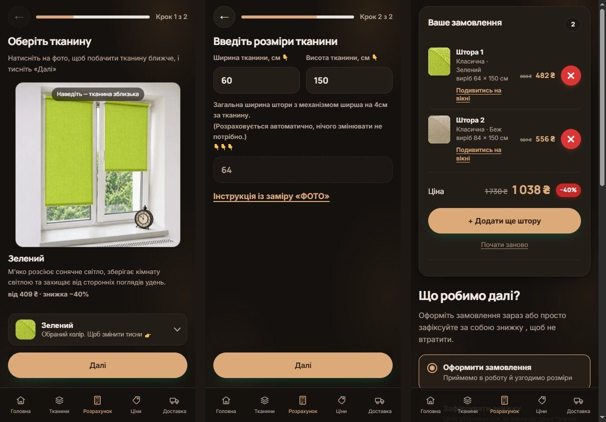
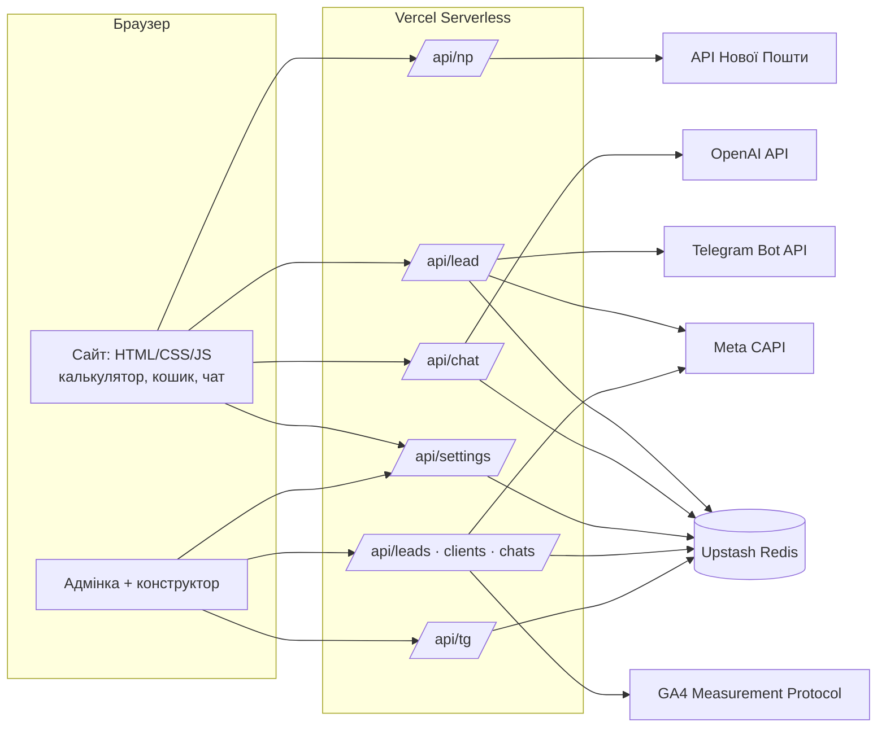

# Фірмова Штора — сайт із калькулятором і адмінкою для виробника рулонних штор

**Живий сайт:** [firmova-shtora.com.ua](https://www.firmova-shtora.com.ua) · комерційний проєкт для реального бізнесу, працює в продакшні.


## Проблема

Невеликий виробник рулонних штор під розмір продавав через дзвінки й месенджери:

- клієнт не міг дізнатися ціну, не написавши менеджеру, — а ціна залежить від ширини, висоти й тканини, і рахувалась вручну;
- заявки губились у різних чатах, ніхто не бачив, звідки прийшов клієнт і чи він купив;
- будь-яку зміну ціни, тексту чи фото на сайті доводилось робити через програміста;
- реклама в Meta й Google не знала, які кліки привели до реальних продажів.

## Рішення

Сайт, який сам рахує ціну, приймає замовлення і передає їх менеджерам, а власник керує ним без програміста.



**Для клієнта**
- **Калькулятор у 2 кроки:** тканина → розміри → ціна одразу, без телефону. Ціна рахується за формулою бізнесу (тариф за висотою + ціна за метр ширини), зі знижкою й окремими тарифами для тканин.
- **Кошик** на кілька штор, візуалізація штори на вікні, гайд із заміру (схема + відео), оформлення з доставкою Новою Поштою (підказки міст і відділень) або фіксація знижки на кілька днів.
- **ШІ-помічник у чаті**, який знає актуальні ціни, тканини й умови з адмінки, а якщо ШІ недоступний — відповідає набором правил.

**Для менеджера**
- Кожна заявка миттєво приходить у **Telegram**; підключення менеджера — одноразовим посиланням з адмінки.
- В адмінці: заявки зі статусами, база клієнтів (групування за телефоном), історія чатів, звідки прийшов клієнт (UTM-мітки реклами).

**Для власника**
- **Адмінка без програміста:** ціни й формула, тканини з фото, знижки (загальна й окремо для тканини), контакти, тексти й фото сайту.
- **Візуальний конструктор:** клікаєш на текст чи фото прямо на сторінці — і змінюєш його.
- Ролі доступу: адміністратор і менеджер (менеджер бачить заявки, але не міняє ціни).

**Для реклами**
- Аналітика GA4, Microsoft Clarity, Meta Pixel — лише після згоди на cookie.
- Серверні події: заявка йде в Meta Conversions API, а коли менеджер позначає заявку «оплачено», сервер надсилає подію покупки в Meta і GA4 — реклама оптимізується на реальні продажі.

## Архітектура



- **Фронтенд** — без фреймворків: статичні сторінки + модульний JavaScript. Налаштування з адмінки накладаються поверх типових значень (`assets/config.js`) і кешуються в браузері, тож сторінка показується миттєво, а потім оновлюється з сервера.
- **Бекенд** — безсерверні функції Vercel, одна на маршрут (`api/`), спільна логіка в `lib/`.
- **Сховище** — Upstash Redis через REST; для розробки той самий інтерфейс працює в пам'яті (`lib/store.js`).

## Інженерні рішення

| Задача | Як вирішено |
|---|---|
| Спам і боти шлють фейкові заявки | Ліміти частоти (з адреси, з номера телефону, добова стеля), перевірка `Origin`, обмеження розміру, білий список полів |
| Подвійне натискання чи повтор після обриву зв'язку | Ключ ідемпотентності: браузер шле `rid`, сервер записує через `SET NX` і не створює дубль |
| Два менеджери міняють статуси одночасно | Кожен статус — окреме поле Redis-хешу (`HSET`), а не один спільний JSON |
| Два адміни зберігають налаштування одночасно | Оптимістичне блокування за версією `savedAt`: на конфлікт сервер відповідає 409, а не затирає |
| Безпечний вхід в адмінку без бази сесій | Паролі в scrypt, сесія — підписана HMAC кука (`HttpOnly`, `Secure`, `SameSite=Strict`), ролі admin / manager |
| Сторонні не повинні отримувати заявки в Telegram | Підписка лише за одноразовим кодом з адмінки, список отримувачів видно й можна прибрати |
| Витрати на ШІ | Окремі лічильники запитів, відмова при збої лічильника, обмеження довжини розмови |
| Одна ціна всюди | Одна формула (`fshRollerBase`) для калькулятора, слайдера тканин, прикладів цін і чат-бота |
| Події браузера й сервера не дублюються в Meta | Спільний `event_id` для Pixel і Conversions API |
| Заявка не губиться, якщо Telegram недоступний | Спершу запис у базу, потім сповіщення; повідомлення шлються паралельно з тайм-аутом |

## Стек

JavaScript (ES2022, без фреймворків) · HTML · CSS · Vercel Serverless Functions (Node.js) · Upstash Redis · Vercel Blob (фото з адмінки) · OpenAI API · Telegram Bot API · API Нової Пошти · Meta Conversions API · GA4 Measurement Protocol · Microsoft Clarity

## Структура

```
index.html, kviz.html, umovy.html, blog.html   сторінки сайту
assets/        стилі, скрипти, фото тканин і робіт
  kviz.js      калькулятор, кошик, оформлення
  api.js       налаштування, формула ціни, згода на cookie, аналітика
  chat.js      інтерфейс чату
  pro.js       головна: слайдер тканин, приклади цін
admin/         адмінка й візуальний конструктор
api/           серверні функції (заявки, налаштування, чат, Telegram, вхід, фото)
lib/           сховище, авторизація, Meta, GA4, знання чат-бота
tools/         генерація відбитка пароля, довідник текстів для адмінки
```

## Запуск локально

```bash
npm install
npx vercel dev
```

Без змінних середовища сайт працює на типових даних, а сховище — у пам'яті. Для повної роботи потрібні:

| Змінна | Для чого |
|---|---|
| `UPSTASH_REDIS_REST_URL`, `UPSTASH_REDIS_REST_TOKEN` | Сховище заявок і налаштувань |
| `ADMIN_PASSWORD_HASH`, `MANAGER_PASSWORD_HASH`, `ADMIN_SESSION_SECRET` | Вхід в адмінку (відбиток: `node tools/hash.mjs`) |
| `TELEGRAM_BOT_TOKEN`, `TELEGRAM_CHAT_ID`, `TELEGRAM_WEBHOOK_SECRET` | Сповіщення менеджерам |
| `OPENAI_API_KEY`, `OPENAI_MODEL` | ШІ-помічник у чаті |
| `NOVAPOSHTA_API_KEY` | Підказки міст і відділень |
| `BLOB_READ_WRITE_TOKEN` | Завантаження фото з адмінки |
| `META_PIXEL_ID`, `META_CAPI_TOKEN`, `GA4_MEASUREMENT_ID`, `GA4_API_SECRET` | Серверні події заявок і покупок |

## Автор

Андрій Гебрин — розробка повністю: дизайн і верстка, калькулятор, серверна частина, адмінка й конструктор, інтеграції.
